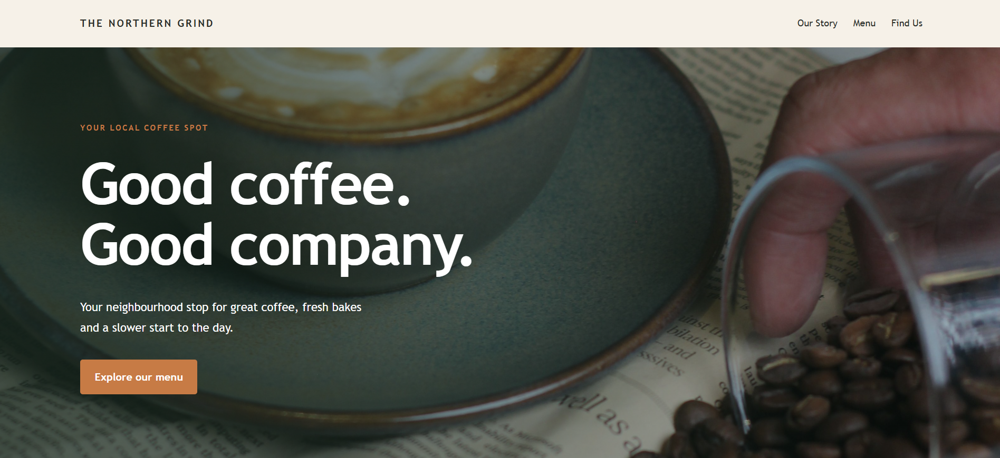

# The Northern Grind ☕

A modern, responsive website concept for **The Northern Grind**, a fictional local café based in Manchester, UK.

The project focuses on creating a welcoming online presence for a neighbourhood café, combining a warm colour palette, clean layouts and subtle animations to create a friendly user experience across desktop and mobile devices.

## 📸 Preview

🌐 Live Website

**[Visit The Northern Grind](https://leoncasburn.github.io/the-northern-grind/)**

## ✨ Features

- **Responsive design** — layouts adapted for desktop and mobile screens.
- **Hero section** — full-width background image with a gradient overlay.
- **Animated ticker** — scrolling café-themed messages.
- **Menu showcase** — sample products, descriptions and illustrative prices.
- **Contact and opening hours** — a dedicated section for essential visitor information.
- **Mobile navigation** — collapsible hamburger menu for smaller screens.
- **Scroll reveal effects** — subtle animations as content enters the viewport.
- **Accessible interactions** — semantic HTML, navigation labels and reduced-motion considerations.

## 🛠️ Built With

- HTML5
- CSS3
- JavaScript

## 🎨 Design

The website uses a warm, café-inspired colour palette featuring forest green, cream and burnt orange. The design aims to balance a distinctive visual identity with clear navigation and readable content.

## 📱 Responsive Design

The layout adapts to different screen sizes, including mobile phones, tablets and desktop displays.

## 🚀 Running Locally

1. Clone or download this repository.
2. Open the project folder.
3. Open `index.html` in your browser.

No additional dependencies or build tools are required.

## 📝 Project Notes

This is a portfolio concept created to develop front-end web development skills and explore website design for local hospitality businesses.

The café, menu items, prices, contact details and opening hours are illustrative and do not represent a real business.

## 👨‍💻 Technologies & Skills Demonstrated

- Semantic HTML structure
- CSS layouts, responsive media queries and custom properties
- CSS animations and transitions
- JavaScript DOM manipulation and event handling
- Mobile navigation and accessibility considerations
- Organising website assets and project files

---

**Created in Manchester, UK.**
